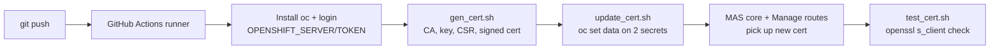

[](https://github.com/istrate/cert-ops/actions/workflows/certmg-github-actions.yml)
# cert-ops

## 1. What the project does

cert-ops automates TLS certificate rotation for an IBM Maximo Application Suite (MAS) deployment on OpenShift. On every push (can be changed to PR, to be reviewed before merging) to GitHub, a pipeline does four things:

1. It generates a new CA and a new wildcard server certificate.
2. It logs in to the OpenShift cluster.
3. It overwrites the MAS public-certificate secrets with the new material.
4. It checks over TLS that the MAS endpoints now serve the new certificate.

## 2. Repository layout

```
cert-ops/
├── README.md                         # This guide + workflow status badge
├── .github/workflows/
│   ├── certmg-github-actions.yml     # The CI/CD pipeline (orchestrator)
│   └── README.md                     # Placeholder: "cert-management flow"
├── certs/
│   ├── certificate.conf              # OpenSSL config (DN, SAN, key usage)
│   └── README.md                     # Placeholder: output directory for generated certs
└── scripts/
    ├── README.md                     # Usage of the scripts, incl. get_sa_token.sh
    ├── get_sa_token.sh               # Prerequisite: create the ServiceAccount + print its long-lived token
    ├── gen_cert.sh                   # Step 1: generate CA + TLS cert
    ├── update_cert.sh                # Step 2: push certs into OpenShift secrets
    └── test_cert.sh                  # Step 3: verify endpoints serve new cert
```

The design separates three concerns:

- **Configuration** is in `certs/`.
- **Logic** is in `scripts/`.
- **Orchestration** is in `.github/workflows/`.

The scripts are plain Bash, so you can run them locally or from any other CI system.

## 3. Flow overview



## 4. Step-by-step implementation

### Step 1 – Create the repo and CI badge

- Create the GitHub repo `istrate/cert-ops` and add this `README.md` with the Actions status badge.
- The badge points at the `certmg-github-actions.yml` workflow and filters on `event=push`.

### Step 2 – Define the certificate template ([`certs/certificate.conf`](certs/certificate.conf))

This is an OpenSSL request config. It has four sections:

| Section | Purpose |
|---|---|
| `[ req ]` | Sets a 2048-bit key and `prompt = no`, so no interactive questions. It also points at the DN and extension sections. |
| `[ req_distinguished_name ]` | Subject: C=RO, ST=Bucuresti, L=Sector 5, O=Home, OU=Lab, and CN=`*.apps.itz-83pcr7.hub04-lb.techzone.ibm.com`. |
| `[ v3_req ]` | `CA:FALSE`, key usage (`digitalSignature`, `keyEncipherment`, `nonRepudiation`), EKU `serverAuth`, and a SAN reference. |
| `[ alt_names ]` | SANs for `*.apps.<cluster-domain>` and `apps.<cluster-domain>`. |

The SAN list is essential because modern clients ignore the CN. The wildcard covers every MAS route, such as `api.dev.apps…` and `dev.manage.dev.apps…`. The bare domain is added separately, since a wildcard does not match it.

### Step 3 – Write the generator ([`scripts/gen_cert.sh`](scripts/gen_cert.sh))

The script runs these steps:

1. It defines a green `log_info` helper and prints `openssl version` as a sanity check.
2. **CA.** `openssl genrsa -out ca.key 2048`, then `openssl req -x509 -new -nodes … -days 365 -out ca.crt`. This produces a self-signed CA.
3. **Server key and CSR.** `genrsa -out tls.key 2048`, then `req -new -key tls.key -out tls.csr -config certificate.conf`.
4. **Signing.** `openssl x509 -req -in tls.csr -CA ca.crt -CAkey ca.key -CAcreateserial -out tls.crt -days 365 -sha256 -extfile certificate.conf -extensions v3_req`. The `-extfile` and `-extensions` options carry the SAN and key usage into the final cert. Without them, `x509 -req` drops the CSR extensions.
5. It prints the cert with `openssl x509 -text -noout` so the details appear in the CI log.

The outputs are `ca.key`, `ca.crt`, `tls.key`, `tls.csr`, `tls.crt` and `ca.srl`. They land in the current directory, which is `certs/` because the workflow sets `working-directory`.

### Step 4 – Write the cluster updater ([`scripts/update_cert.sh`](scripts/update_cert.sh))

The script uses `set -e`, so it stops on the first error. Its steps:

1. **Parameterise MAS naming conventions** with environment-variable defaults:
   - `INSTANCE_ID` (default `dev`) and `WORKSPACE_ID` (default `dev`). **These can be passed as environment variables on GitHUb Actions**
   - Namespaces: `mas-<instance>-core` and `mas-<instance>-manage`.
   - Secrets: `<instance>-cert-public` (core) and `<instance>-<workspace>-cert-public-81` (Manage workspace).
2. **Validate** that `tls.crt`, `tls.key` and `ca.crt` exist in the working directory. It exits with an error if any is missing.
3. **Update the two existing secrets** in place:
   ```
   oc set data secret/<name> -n <ns> \
     --from-file=tls.crt=… --from-file=tls.key=… --from-file=ca.crt=…
   ```
   It updates the secrets rather than recreating them, so ownership, labels and annotations that MAS relies on are preserved.

### Step 5 – Write the verifier ([`scripts/test_cert.sh`](scripts/test_cert.sh))

The script also uses `set -e`. Its steps:

1. It builds the target URLs from the MAS convention:
   - Manage: `https://<ws>.manage.<inst>.<CN>`
   - Core API: `https://api.<inst>.<CN>`
2. `extract_host` pulls the hostname from each URL with `awk -F/`.
3. `test_endpoint_ssl` runs `echo | openssl s_client -connect host:443 -servername host`. This is a real TLS handshake with SNI.
4. If the output contains `BEGIN CERTIFICATE`, it prints the subject, issuer, validity dates and SHA-256 fingerprint. It reports PASSED only if the fingerprint matches the newly generated `tls.crt`. Otherwise it returns 1.
5. Chain validation errors are deliberately ignored (`|| true`). The CA is private, so the test compares fingerprints instead of validating the chain.
6. **Retry.** The operator takes time to replace the certificates, so a failed attempt is not final. The script retests the failing endpoints every 3 minutes (`RETRY_DELAY_SECONDS=180`) for up to 20 minutes (`TIMEOUT_MINUTES=20`). Endpoints that already passed are not tested again. If any endpoint is still failing at the timeout, it exits with 1 and fails the CI job. Both values can be overridden with environment variables.

### Step 6 – Wire it together in GitHub Actions ([`certmg-github-actions.yml`](.github/workflows/certmg-github-actions.yml))

- **Trigger:** `on: [push]`.
- **Runner:** `ubuntu-latest`, with `defaults.run.working-directory: ./certs`. This is why the scripts use relative file names and are called as `../scripts/…`.
- **Steps:**
  1. `actions/checkout@v6`.
  2. `redhat-actions/oc-installer@v1` installs the `oc` CLI (`latest`, or pin a version such as 4.20).
  3. `oc login --server=$OPENSHIFT_SERVER --token=$OPENSHIFT_TOKEN`.
  4. `chmod +x ../scripts/gen_cert.sh && ../scripts/gen_cert.sh`.
  5. The same pattern for `update_cert.sh`.
  6. The same pattern for `test_cert.sh`.

### Step 7 – Configure GitHub secrets and cluster access (prerequisites)

1. In the repo, go to *Settings → Secrets and variables → Actions* and add:
   - `OPENSHIFT_SERVER`, the API URL such as `https://api.<cluster>:6443`.
   - `OPENSHIFT_TOKEN`, a long lived token for a ServiceAccount or user.
2. On the cluster, create a ServiceAccount whose Role or RoleBinding allows `get`, `patch` and `update` on secrets. This must cover `mas-<inst>-core` and `mas-<inst>-manage`. Use its token instead of a personal `oc whoami -t` token, which expires.
3. The target secrets must already exist. `oc set data` fails if they don't.
4. Update the CN and SANs in `certificate.conf`, the CN in `gen_cert.sh`, and the default `CN` in `test_cert.sh` if you point this at a different cluster.

### Step 8 – Run and observe

1. Push a commit. The workflow runs and the README badge shows pass or fail.
2. Read the logs. They print the OpenSSL text dump, `Successfully updated both existing secrets…`, and the per-endpoint PASSED lines.

