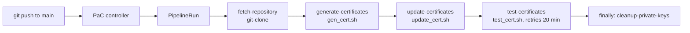

# Tekton / OpenShift Pipelines (Pipelines as Code)

This folder and [`../.tekton/cert-ops.yaml`](../.tekton/cert-ops.yaml) run the same certificate rotation as the GitHub Actions workflow, but inside the OpenShift cluster with **OpenShift Pipelines** and **Pipelines as Code (PaC)**.

The pipeline calls the same scripts in [`../scripts`](../scripts), so the two CI systems behave the same way.

## How it differs from GitHub Actions

| | GitHub Actions | Tekton (PaC) |
|---|---|---|
| Definition | `.github/workflows/certmg-github-actions.yml` | `.tekton/cert-ops.yaml` |
| Runs on | GitHub-hosted runner | Pods in the OpenShift cluster |
| Cluster access | `oc login` with `OPENSHIFT_SERVER` and `OPENSHIFT_TOKEN` secrets | None. `oc` uses the token of the `pipeline` ServiceAccount that runs the pod |
| Tools | Installed with `redhat-actions/oc-installer` | Provided by the `tools-image` parameter |
| Clone | `actions/checkout` | `git-clone` cluster task |
| Private keys | Discarded with the runner | Removed by a `finally` task, then the PVC is deleted with the run |
| Trigger | `on: [push]` | `on-event: [push]`, `on-target-branch: [main]` |

Because no token leaves the cluster, the long-lived token from `get_sa_token.sh` is **not needed** for Tekton.

## Pipeline



All tasks share one workspace (`source`), a PVC created per run. The repository is cloned into it, and the scripts run with `certs/` as the working directory, exactly as in the GitHub workflow.

## Prerequisites

- OpenShift with the **Red Hat OpenShift Pipelines** operator installed. This includes Pipelines as Code.
- `oc` and, optionally, the `tkn-pac` CLI.
- `cluster-admin` for the one-time setup.
- A tools image that provides `bash`, `openssl`, `oc`, `awk` and `grep`. The default is `image-registry.openshift-image-registry.svc:5000/openshift/cli:latest`. Check that it contains `openssl`. Each task checks for its tools and fails with a clear message if one is missing. If one is missing, build a small image or override the `tools-image` parameter.

## Setup

### 1. Create the namespace

```bash
oc new-project cert-ops
# The operator creates the 'pipeline' ServiceAccount in every namespace
oc get sa pipeline -n cert-ops
```

### 2. Grant the pipeline ServiceAccount access to the MAS secrets

Run the helper script. It creates the Role and RoleBinding in `mas-<inst>-core` and `mas-<inst>-manage`. They allow `get`, `patch` and `update` on only the two certificate secrets. `CREATE_TOKEN=false` skips the long-lived token.

```bash
INSTANCE_ID=dev WORKSPACE_ID=dev \
SA_NS=cert-ops SA_NAME=pipeline CREATE_TOKEN=false \
  ./scripts/get_sa_token.sh
```

Use the same `INSTANCE_ID` and `WORKSPACE_ID` as the pipeline parameters.

### 3. Connect the repository to Pipelines as Code

**Option A – `tkn pac` CLI (recommended).** It creates the Repository CR, the secret and the GitHub webhook.

```bash
tkn pac create repository
# Repository URL: https://github.com/istrate/cert-ops
# Namespace:      cert-ops
```

**Option B – manual webhook.**

1. Create a GitHub personal access token. A fine-grained token needs *Contents: read* and *Metadata: read* on the repo, plus *Webhooks: read/write* if you create the hook through the API. Skip the hook step if you add the webhook by hand.
2. Create the secret and the Repository CR:

   ```bash
   oc create secret generic github-webhook-config -n cert-ops \
     --from-literal=provider.token=<token> \
     --from-literal=webhook.secret=<random-string>
   oc apply -f tekton/repository.yaml
   ```

3. In GitHub, go to *Settings → Webhooks → Add webhook*:
   - Payload URL: the PaC route, from `oc get route pipelines-as-code-controller -n openshift-pipelines`.
   - Content type: `application/json`.
   - Secret: the same `webhook.secret`.
   - Events: *Pushes* and *Pull requests*.

If you installed the PaC GitHub App instead, only the Repository CR is needed.

### 4. Run it

Push a commit to `main`. PaC finds `.tekton/cert-ops.yaml`, starts a PipelineRun in `cert-ops` and reports the status on the commit.

```bash
tkn pac logs -n cert-ops -L          # follow the latest run
tkn pipelinerun list -n cert-ops
oc get pipelinerun -n cert-ops
```

The OpenShift console has the same view under *Pipelines → PipelineRuns*.

## Parameters

Defined in `.tekton/cert-ops.yaml` under `pipelineSpec.params`. Edit the defaults there.

| Parameter | Default | Meaning |
|---|---|---|
| `instance-id` | `dev` | MAS instance ID |
| `workspace-id` | `dev` | MAS workspace ID |
| `cn` | `apps.itz-83pcr7.hub04-lb.techzone.ibm.com` | Base domain of the routes. Used by `test_cert.sh` |
| `timeout-minutes` | `20` | How long `test_cert.sh` retries |
| `retry-delay-seconds` | `180` | Delay between retries |
| `tools-image` | `…/openshift/cli:latest` | Image used by every step |

`gen_cert.sh` and `certs/certificate.conf` still hard-code the cluster domain, as with GitHub Actions.

## Things to know

- **Run only one CI system.** Both workflows rotate the certificates on every push to `main`. Running both makes the certificates change twice, and `test_cert.sh` of one run may see the certificate of the other run. Disable one of them. To turn off GitHub Actions, use *Actions → Disable workflow* or delete the workflow file. To turn off Tekton, delete the Repository CR.
- **Timeout.** The pipeline timeout is 1 hour. The test task alone can use 20 minutes when the operator is slow.
- **Private keys.** The CA and TLS keys exist only in the per-run PVC. The `finally` task deletes them, and the PVC is removed with the PipelineRun. They are never stored in Git or in a secret. As with GitHub Actions, a new CA is generated on every run.
- **Pull requests.** The pipeline only runs for pushes to `main`. A pull request would otherwise rotate production certificates. To change this, edit the `on-event` and `on-target-branch` annotations.
- **Pod security.** The pods run as UID 65532 (allowed by the `pipelines-scc` that the `pipeline` ServiceAccount uses) so that `git-clone` and the script steps use the same user. Do not set `fsGroup` in the `podTemplate`: `pipelines-scc` rejects 65532 as an `fsGroup`, and the pipeline's affinity-assistant pod fails to start with the same value, so every task stays `Pending`. The SCC assigns an allowed `fsGroup` itself.
- **Cleanup.** PaC keeps the last 5 runs (`max-keep-runs`).

## Troubleshooting

| Symptom | Likely cause |
|---|---|
| Nothing starts after a push | Check the webhook delivery in GitHub and `oc get repository -n cert-ops`. Check that the branch is `main` |
| `'openssl' is missing in the tools image` | Use another `tools-image` that contains it |
| `Permission denied` writing in `certs/` | The pod user does not match the workspace owner. Keep `runAsUser` at 65532, and do not set `fsGroup` (see *Pod security*) |
| All task pods stay `Pending` with `didn't match pod affinity rules` | The `affinity-assistant` StatefulSet cannot create its pod. Run `oc get events -n cert-ops \| grep FailedCreate`. An SCC error on `fsGroup` or `runAsUser` means the `podTemplate` `securityContext` is not allowed. Remove the offending field |
| `Error from server (Forbidden)` in `update-certificates` | Step 2 was skipped or used different `INSTANCE_ID`/`WORKSPACE_ID` values. Check with `oc auth can-i patch secret/<name> -n <ns> --as=system:serviceaccount:cert-ops:pipeline` |
| `git-clone` task not found | Your operator version is older than 1.15. Install the Task in the namespace, or replace the resolver with `hub` |
| `missing values for these params … [URL]` in `git-clone` | The `git-clone` task in `openshift-pipelines` uses upper-case parameter names (`URL`, `REVISION`, `DELETE_EXISTING`). If your operator version uses lower-case names, check them with `oc get task git-clone -n openshift-pipelines -o jsonpath='{.spec.params[*].name}'` and adjust the `fetch-repository` params |
| `test-certificates` times out | The operator has not yet deployed the new certificate. Raise `timeout-minutes`, and check that the operator serves exactly the generated `tls.crt` |
